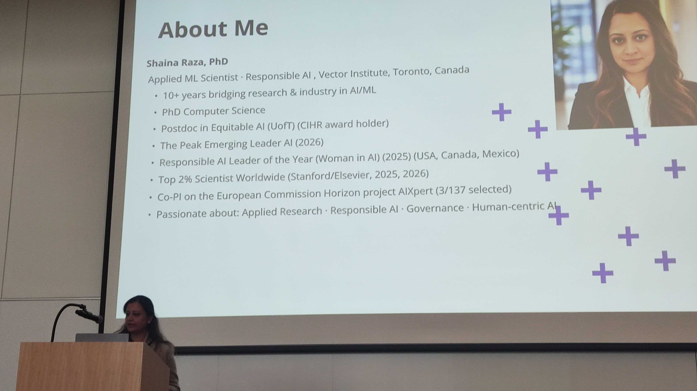
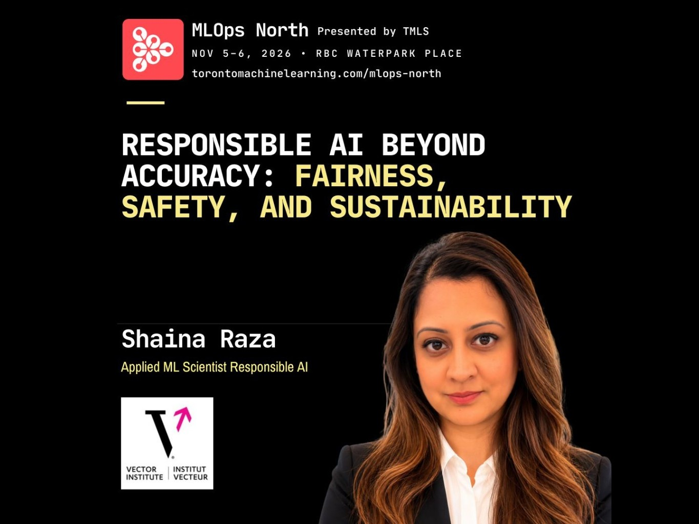
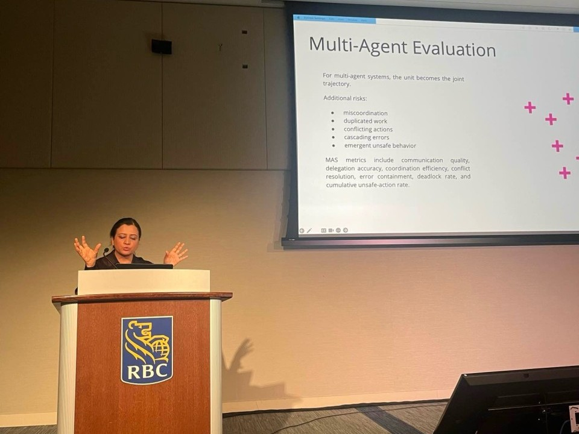
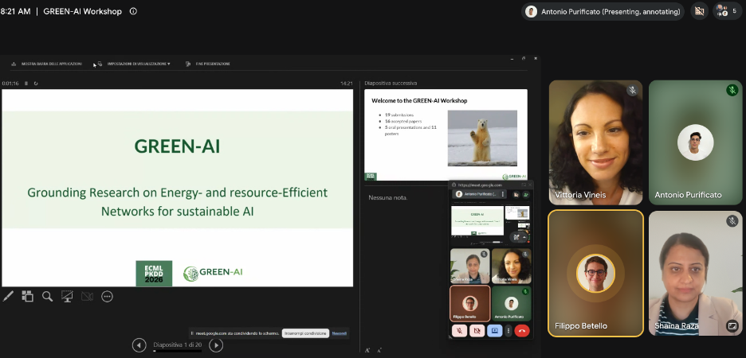
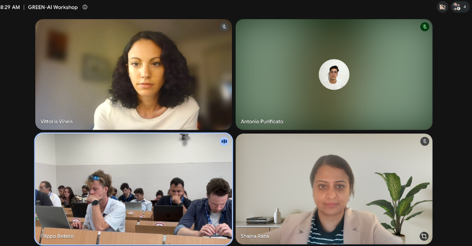
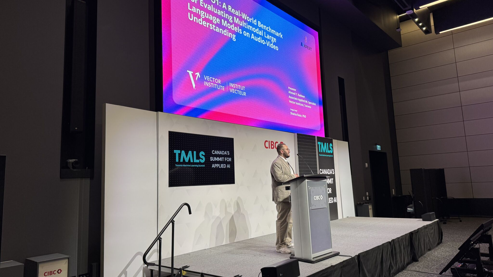
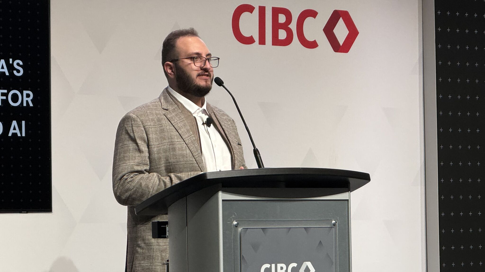
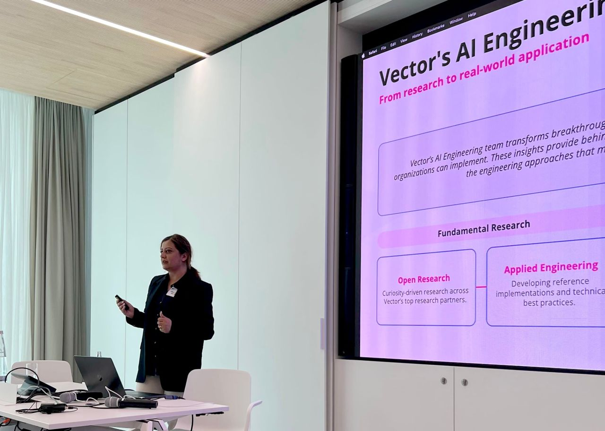
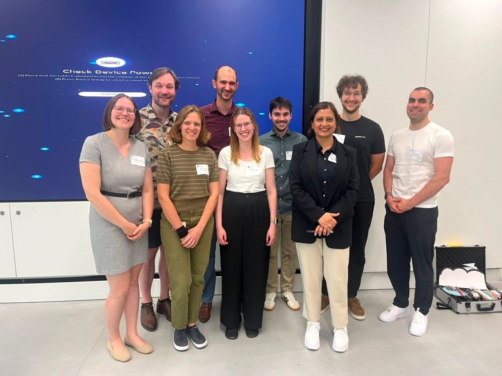
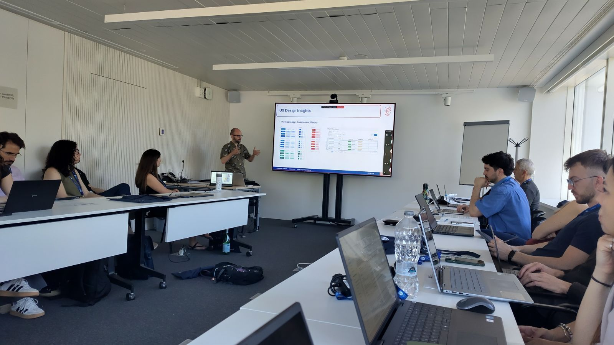

# Updates

Papers, releases, talks, and news in reverse chronological order. Each entry is tagged by type: Paper · Preprint · Release · Talk · Event · Press · Award.

---

## Featured projects

- :material-star-circle: **DIA (Data & Impact Accounting)** <strong>(Featured Project)</strong>. Open-source toolkit that tracks the **energy, water, and CO₂** footprint of open-source AI models and their derivatives, now released as the `ai-impact-accounting` package with code, docs, and an interactive dashboard. [Project page](https://vectorinstitute.github.io/ai-impact-accounting/) · [Code](https://github.com/VectorInstitute/ai-impact-accounting/) · [PyPI](https://pypi.org/project/ai-impact-accounting/) · [Dashboard](https://huggingface.co/spaces/vector-institute/dia-dashboard) · [ICML 2026 paper](https://proceedings.mlr.press/v306/raza26a.html)

- :material-star-circle: **FairSense-AgentiX** <strong>(Featured Project)</strong>. Agentic fairness and AI-risk platform for text, images, and datasets (FastAPI, WebSocket, React UI, Python API). [Paper](https://joss.theoj.org/papers/10.21105/joss.11060) · [Project page](https://vectorinstitute.github.io/fairsense-agentix/) · [Code](https://github.com/VectorInstitute/fairsense-agentix) · [PyPI](https://pypi.org/project/fairsense-agentix/)

- :material-star-circle: **UnBias-Plus** <strong>(Featured Project)</strong>. Toolkit for **bias detection, explanation, severity assessment, and debiasing** in text (segmentation, severity scoring, reasoning, replacements, and full rewrite). [Paper](https://arxiv.org/abs/2606.23412) · [Project page](https://vectorinstitute.github.io/unbias-plus/) · [Code](https://github.com/VectorInstitute/unbias-plus) · [Demo](https://unbias-plus.vectorinstitute.ai/) · [PyPI](https://pypi.org/project/unbias-plus/)

---

## 2026

- **14 Nov 2026** · Press · :material-newspaper: **Deepfakes in CBC News**. Shaina Raza's deepfake work is featured in coverage of an AI-generated scam video that paired an Elora, Ont. manufacturer's real marketing images with a washing machine the company does not make. [Article](https://www.cbc.ca/news/canada/kitchener-waterloo/stirling-marathon-9.7421011).

- **12 Nov 2026** · Press · :material-newspaper: **Deepfakes in The New York Times**. Our deepfake work by Shaina Raza is featured in coverage of AI-generated fakes in midterm memes. [Article](https://www.nytimes.com/2026/11/12/technology/artifical-intelligence-fakes-midterm-memes.html).

- **12 Nov 2026** · Talk · :material-presentation: **CIFAR AI Safety Week**. Shaina Raza presented deepfake generation and detection, including **MARS** and **Mozaic**, at CAISI during CIFAR AI Safety Week (Toronto). [Post](https://www.linkedin.com/posts/cifar_as-ai-safety-week-wraps-up-in-toronto-researchers-activity-7527029349343068161-garv).

  

- **Nov 2026** · Release · :material-rocket-launch: **MARS**. Video forgery detector for facial manipulation and fully generated video that reports the frames and regions it used. [Project page](https://vectorinstitute.github.io/mars/) · [Preprint](https://arxiv.org/abs/2611.12508) · [Code](https://github.com/VectorInstitute/mars).

- **5–6 Nov 2026** · Talk · :material-presentation: **MLOps North 2026**. Shaina Raza spoke on responsible AI beyond accuracy: fairness, safety, and sustainability, from agent trajectories to safety, reliability, and governance (Toronto). [Summit](https://www.torontomachinelearning.com/) · [Presenter page](https://www.torontomachinelearning.com/presenter/shaina-raza/).

  
  

- **Nov 2026** · Paper · :material-check-decagram: **FairSense-AgentiX published in JOSS**. Agentic fairness and AI-risk platform for text, images, and datasets (FastAPI, WebSocket, React UI, Python API). [Paper](https://joss.theoj.org/papers/10.21105/joss.11060) · [Project page](https://vectorinstitute.github.io/fairsense-agentix/) · [Code](https://github.com/VectorInstitute/fairsense-agentix) · [PyPI](https://pypi.org/project/fairsense-agentix/).
- **EMNLP 2026 (Main)** · Paper · :material-check-decagram: **SONIC-O1 accepted at EMNLP 2026**. Real-world audio-video benchmark for evaluating multimodal LLMs. [Project page](https://vectorinstitute.github.io/sonic-o1/) · [Paper](https://aclanthology.org/2026.emnlp-main.767/) · [Code](https://github.com/VectorInstitute/sonic-o1) · [Dataset](https://huggingface.co/datasets/vector-institute/sonic-o1) · [Leaderboard](https://huggingface.co/spaces/vector-institute/sonic-o1-leaderboard).

- **EMNLP 2026 (Industry)** · Paper · :material-check-decagram: **DiagFlowBench accepted at EMNLP 2026**. [_Evaluating How Language Models Handle Off-Procedure Inputs in Grounded Diagnostic Dialogue_](https://aclanthology.org/2026.emnlp-industry.108/).

- **NeurIPS 2026 AABA4ET** · Paper · :material-check-decagram: **AgentFinVQA accepted**. Auditable financial chart QA pipeline for regulated, on-premise use, with traceable Model Evaluation Packets. [Project page](https://vectorinstitute.github.io/AgentFinVQA/) · [Preprint](https://arxiv.org/abs/2606.19782) · [Code](https://github.com/VectorInstitute/AgentFinVQA/).

- **NeurIPS 2026 TAE** · Paper · :material-check-decagram: **Detecting Deception, Not Deepfakes accepted**. Position paper on why artifact detectors miss interactive deception, adding a communication layer for speech acts, conversation, and influence. [Project page](https://jesseeho.github.io/deepfake-deception/) · [Preprint](https://arxiv.org/abs/2605.09007).

- **NeurIPS 2026 TAE** · Paper · :material-check-decagram: **Stress-Testing Efficient Responsible-AI Evaluation accepted**. Study of how batching, quantization, and smaller subsets change bias-benchmark conclusions and energy use on BBQ and BBQ-V. [Project page](https://vectorinstitute.github.io/sustainable-rai-evaluation/) · [Preprint](https://arxiv.org/abs/2608.31108) · [Code](https://github.com/VectorInstitute/sustainable-rai-evaluation).

- **Sep 2026** · Preprint · :material-file-document: **Harness-Aware Evaluation of LLM Agents**. Survey of how memory, tools, and execution software around an LLM change reported agent scores. [Project page](https://vectorinstitute.github.io/harness-aware-evaluation/) · [Preprint](https://www.preprints.org/manuscript/202609.2140) · [Code](https://github.com/VectorInstitute/harness-aware-evaluation).

- **Sep 2026** · Preprint · :material-book-open-variant: **Unified evaluation framework**. Framework for trustworthy evaluation across LLMs, agentic AI, and multimodal systems, with shared scoring bands and links to the EU AI Act, ISO, and NIST AI RMF. [Preprint](https://arxiv.org/abs/2609.19524).

- **Sep 2026** · Release · :material-chart-bar: **FairLens**. Fairness benchmark for VLMs on high-stakes hiring, legal, and healthcare decisions from a face photograph, measuring parity, soundness, and refusal to judge from appearance. [Project page](https://vectorinstitute.github.io/fairlens/) · [Preprint](https://arxiv.org/abs/2609.01691) · [Code](https://github.com/VectorInstitute/fairlens) · [Dataset](https://huggingface.co/datasets/vector-institute/fairlens).

- **ECML-PKDD 2026** · Talk · :material-presentation: **Green AI Workshop keynote**. Shaina Raza delivered a keynote presenting **DIA** and the ICML 2026 Spotlight Position Paper on tracking the cumulative energy, carbon, and water footprint of model derivatives. [Program](https://sites.google.com/uniroma1.it/green-ai-workshop/editions/ecml-pkdd-2026/program) · [Project](https://vectorinstitute.github.io/ai-impact-accounting/).

  
  

- **Aug 2026** · Preprint · :material-file-document: **Deepfakes in the Foundation-Model Era**. Survey of forensics, generation, and platform distribution. Detectors built for older deepfakes often miss newer ones circulating online. [Project page](https://vectorinstitute.github.io/deepfakes-survey-2026/) · [Preprint](https://www.preprints.org/manuscript/202608.1870) · [Code](https://github.com/VectorInstitute/deepfakes-survey-2026).

- **ICML 2026** · Paper · :material-leaf: **ICML 2026 Poster**. [_Position: Sustainable Open-Source AI Requires Tracking the Cumulative Footprint of Derivatives_](https://proceedings.mlr.press/v306/raza26a.html) accepted as a poster at ICML 2026. Shaina Raza, Ahmed Radwan, and co-authors propose **Data and Impact Accounting (DIA)** to make the cumulative environmental footprint of open-source AI model derivatives visible and accountable. [Project page](https://vectorinstitute.github.io/ai-impact-accounting/) · [Code](https://github.com/VectorInstitute/ai-impact-accounting/) · [PyPI](https://pypi.org/project/ai-impact-accounting/).

- **ACL 2026 Findings** · Paper · :material-check-decagram: **F-DPO**. [_Reducing Hallucinations in LLMs via Factuality-Aware Preference Learning_](https://aclanthology.org/2026.findings-acl.1968/). [Project page](https://vectorinstitute.github.io/Factual-Preference-Alignment/) · [Code](https://github.com/VectorInstitute/Factual-Preference-Alignment) · [Dataset](https://huggingface.co/datasets/vector-institute/Factuality_Alignment).

- **Jun–Jul 2026** · Press · :material-newspaper: **UnBias-Plus in the press**. Independent coverage of the open-source writing-bias detector and rewrite toolkit (healthcare, HR/AI workflows, and AI training-data screening): [CAN Health](https://www.canhealth.com/2026/07/08/unbias-plus-ai-tool-detects-and-rewrites-bias-in-text) (8 Jul 2026) · [ChannelLife](https://channellife.ca/story/vector-institute-launches-open-source-writing-bias-detector) (2 Jul 2026) · [AI Loop](https://www.ailoop.tech/article/vector-institute-unveils-unbias-plus-tool-to-detect-ai-bias) (22 Jul 2026) · [BornCity](https://borncity.com/news/unbias-plus-vector-institute-startet-kostenloses-bias-erkennungs-tool/) (3 Jul 2026) · [TechTalent.ca](https://techtalent.ca/vector-institute-launches-free-ai-tool-to-help-hr-and-ai-teams-detect-bias-in-text/) (Jul 2026) · [GlobeNewswire](https://www.globenewswire.com/news-release/2026/06/30/3319532/0/en/vector-institute-releases-unbias-plus-a-free-open-source-ai-tool-to-detect-and-rewrite-bias-in-text.html) (30 Jun 2026) · [BNN Bloomberg](https://www.bnnbloomberg.ca/press-releases/2026/06/30/vector-institute-releases-unbias-plus-a-free-open-source-ai-tool-to-detect-and-rewrite-bias-in-text/) (30 Jun 2026).

- **WCCI 2026 (IJCNN)** · Paper · :material-check-decagram: **Model immunization (AI vaccine)**. [_Just as Humans Need Vaccines, So Do Models: Model Immunization to Combat Falsehoods_](https://arxiv.org/abs/2505.17870) (arXiv). [Project page](https://shainarazavi.github.io/ai-vaccine/) · [Code](https://github.com/shainarazavi/ai-vaccine).

- **Jun 2026** · Paper · :material-video-off: **Deepfake Video Review**. [_Generative Deepfake Videos in the Foundation-Model Era: A Timeline of Eroding Trust in Visual Evidence_](https://dl.acm.org/doi/full/10.1145/3810988.3812659) published at MAD '26 (ACM Workshop on Multimedia AI against Disinformation). Shaina Raza, Jessee Ho, Mahveen Raza, Christos Emmanouilidis.

- **16–19 Jun 2026** · Talk · :material-presentation: **Toronto Machine Learning Summit**. Ahmed Y. Radwan presented **SONIC-O1** at the [Toronto Machine Learning Summit](https://www.torontomachinelearning.com/) (Toronto). SONIC-O1 is a real-world benchmark for evaluating multimodal LLMs on audio-video understanding across 13 conversational domains, featuring a public leaderboard for model comparison and fairness analysis.

  [Project page](https://vectorinstitute.github.io/sonic-o1/) · [Code](https://github.com/VectorInstitute/sonic-o1) · [Dataset](https://huggingface.co/datasets/vector-institute/sonic-o1) · [Leaderboard](https://huggingface.co/spaces/vector-institute/sonic-o1-leaderboard)

  
  

- **8–11 Jun 2026** · Award · :material-handshake: **HAICON26 & Vector-Helmholtz Munich MOU**. Shaina Raza, PhD presented at the [Helmholtz AI Conference 2026: AI for Science](https://haicon.cc/) (Munich). The visit coincided with the signing of a **Memorandum of Understanding (MOU)** between Vector Institute and Helmholtz Munich's Computational Health Center, establishing a formal framework for joint research, researcher exchanges, faculty affiliations, and coordinated Germany-Canada funding programs.

  [Helmholtz Munich](https://www.helmholtz-munich.de/en/newsroom/news-all/artikel/helmholtz-munich-and-vector-institute-strengthen-international-ai-research-collaboration) · [Press release (GlobeNewsWire)](https://www.globenewswire.com/news-release/2026/06/11/3310530/0/en/vector-institute-and-helmholtz-munich-sign-mou-to-advance-international-ai-and-machine-learning-research.html) · [AI Magazine](https://aimagazine.com/globenewswire/3310530) · [BNN Bloomberg](https://www.bnnbloomberg.ca/press-releases/2026/06/11/vector-institute-and-helmholtz-munich-sign-mou-to-advance-international-ai-and-machine-learning-research/)

  
  

- **3–4 Jun 2026** · Event · :material-map-marker: **AIXpert General Assembly: Barcelona 2026**. The AIXPERT consortium met at the [Barcelona Supercomputing Center](https://www.bsc.es/) for its second-year General Assembly and Technical Meeting. Partners aligned the technical roadmap, validated implementation plans across five pilot domains (healthcare, recruitment, manufacturing, education, and creative industries), and prepared the next phase of platform development. [Read more](https://aixpert-project.eu/2026/06/05/ga-bcn-june2026/).

  

- **May–Jun 2026** · Talk · :material-presentation: **AI4Good Lab 2026**. Shaina Raza, PhD and Ahmed Y. Radwan presented **UnBias-Plus** and research on disinformation and misinformation detection to the [AI4Good Lab](https://www.ai4goodlab.com/) 2026 cohort (Toronto). The AI4Good Lab is a full-time summer ML training program for women and gender diverse people across Canada, hosted in Toronto in partnership with Vector Institute and CIFAR.

- **20 Apr 2026** · Event · :material-presentation: **EU cluster webinar: AI in public services**. We contributed to the webinar *AI-Enabled Public Services: Building Resilience and Accountability* (10:00 CEST). The session was the second joint online event organized by the EU-funded projects **TANGO**, **AI4REALNET**, **HumAIne**, **THEMIS 5.0**, and **Peer AI**, bringing together speakers on how these initiatives use AI in public-service settings, with emphasis on **resilience** and **accountability**. Registration was open to the general public, researchers, and policy makers; registered participants received the detailed agenda in the weeks before the event.

- **Feb 2026** · Preprint · :material-file-document: **From Features to Actions**. [_Explainability in Traditional and Agentic AI Systems_](https://arxiv.org/abs/2602.06841) (arXiv). [Code](https://github.com/VectorInstitute/unified-xai-evaluation-framework) · [Project page](https://vectorinstitute.github.io/unified-xai-evaluation-framework/).

- **28 Jan 2026** · Press · :material-newspaper: **AIXpert news**. Our work was highlighted on the [AIXpert project website](https://aixpert-project.eu/2026/01/28/advancing-trustworthy-explainable-and-responsible-ai-at-neurips-2025/): *Advancing Trustworthy, Explainable, and Responsible AI at NeurIPS 2025* (Bias in the Picture, HumaniBench, Carbon Literacy, and more).

### Dated 2026, month to confirm

- **ACM TIST** · Paper · :material-check-decagram: **HumaniBench accepted at ACM TIST**. Fairness-focused vision-language benchmark published in *ACM Transactions on Intelligent Systems and Technology*. [Project page](https://vectorinstitute.github.io/HumaniBench/) · [Paper](https://dl.acm.org/doi/10.1145/3845999).

- **Information Fusion** · Paper · :material-check-decagram: **Evaluating and Regulating Agentic AI**. [_Evaluating and Regulating Agentic AI: A Study of Benchmarks, Metrics, and Regulation_](https://www.sciencedirect.com/science/article/pii/S1566253526003246). [Project page](https://itsazibfarooq.github.io/agenticEvaluation/) · [Code](https://github.com/itsazibfarooq/agenticEvaluation).

- **AI Open (Elsevier)** · Paper · :material-check-decagram: **TRiSM for Agentic AI accepted**. Paper accepted at [AI Open, Elsevier 2026](https://doi.org/10.1016/j.aiopen.2026.02.006). A review of trust, risk, and security management in LLM-based agentic multi-agent systems.

- **IASEAI 2026** · Paper · :material-file-document: **Detecting and Reasoning About Bias in Multimodal Content**. [Paper](https://ojs.aaai.org/index.php/IASEAI/article/view/43054).

- **2026** · Award · :material-trophy: **Stanford/Elsevier Top 2% Scientists 2026**. Shaina Raza was recognized among the World's Top 2% Scientists in the [2026 Stanford/Elsevier database](https://elsevier.digitalcommonsdata.com/datasets/btchxktzyw/9) for the second consecutive year.

- **2026** · Award · :material-trophy: **The Peak Emerging Leaders 2026**. Shaina Raza, PhD has been recognized in [The Peak's Emerging Leaders 2026](https://emergingleaders.readthepeak.com/2026/artificial-intelligence) list, celebrating Canada's most promising young leaders in **Artificial Intelligence**.

- **2026** · Talk · :material-presentation: **NVIDIA: Responsible AI & Transparency**. Shaina Raza presented **DIA** as a lightweight transparency layer for the energy, water, and carbon footprint of open models and their derivatives (1:30–1:50 pm). [Project](https://vectorinstitute.github.io/ai-impact-accounting/).

- **2026** · Talk · :material-presentation: **Remarkable 2026**. We presented AIXpert projects at Remarkable 2026.

  
  

- Press · :material-newspaper: **Deepfakes in the Niagara Falls Review**. A Toronto expert on red flags in deepfake videos. [Article](https://www.niagarafallsreview.ca/news/municipal-elections/deepfake-videos-online-toronto-expert-explains-red-flags/article_408c9887-c76a-5c62-a55a-39460cb59d71.html).

- Press · :material-newspaper: **DIA in the press**. Nosian Magazine's [_AI's Unasked Question: What Did That Cost?_](https://nosian.substack.com/p/ais-unasked-question-what-did-that) features **DIA** and the team behind it (Amrit Krishnan, Shaina Raza, PhD, and Ahmed Y. Radwan; written by Sally Work), on why so few ICML papers measure AI's environmental cost and how the `ai-impact-accounting` package helps.

- Press · :material-microphone: **The AmberMac Show (Ep. 076)**. Kathryn Hume, VP of AI Engineering at Vector Institute, discusses [AI bias](https://ambermac.com/the-ambermac-show-ep076-rogue-ai-tiktok-doctors-angry-elon/) and how AI is reshaping high-stakes decisions like hiring and mortgage approvals, and what's needed to reduce bias and discrimination.

- Press · :material-post: **MoE blog**. [_Mixture of Experts: From Sparse Routing to Multimodal Deployment_](https://vectorinstitute.ai/mixture-of-experts-from-sparse-routing-to-multimodal-deployment/).

- Preprint · :material-book-open-variant: **Transparency in Agentic AI**. Survey: [_A Survey of Interpretability, Explainability, and Governance_](https://doi.org/10.31224/6451). [Project page](https://vectorinstitute.github.io/Agentic-Transparency/).

- Preprint · :material-file-document-edit-outline: [_Responsible Agentic Reasoning and AI Agents: A Critical Survey_](https://www.techrxiv.org/users/574774/articles/1329333-responsible-agentic-reasoning-and-ai-agents-a-critical-survey?mode=edit) (TechRxiv).

- Release · :material-database: **Mozaic**. Audio-video deepfake benchmark that labels the face and the voice separately and asks which part is fake, what kind, whose identity, and why. Zero-shot models catch fake video far more often than fake audio. Paper coming. [Project page](https://vectorinstitute.github.io/mozaic/) · [Code](https://github.com/VectorInstitute/mozaic) · [Dataset](https://huggingface.co/datasets/vector-institute/Mozaic).

- Release · :material-play-circle: **SONIC-O1 release**. Dataset on [Hugging Face](https://huggingface.co/datasets/vector-institute/sonic-o1) (231 videos, ~60h, 4,958 QAs, 13 domains, demographic metadata), [code and evaluation pipeline](https://github.com/VectorInstitute/sonic-o1) (summarization, MCQ, temporal localization), and a [leaderboard](https://huggingface.co/spaces/vector-institute/sonic-o1-leaderboard) for model comparisons and fairness analysis.

- Release · :material-robot: **SONIC-O1 Multi-Agent**. Compound multi-agent system for audio-video understanding. [Code](https://github.com/VectorInstitute/sonic-o1-agent).

- Release · :material-database: **F-DPO release**. Factuality-aware preference [dataset](https://huggingface.co/datasets/vector-institute/Factuality_Alignment) on Hugging Face, with [code](https://github.com/VectorInstitute/Factual-Preference-Alignment) and [project page](https://vectorinstitute.github.io/Factual-Preference-Alignment/) (factuality-aware DPO, no reward model).

- Release · :material-rocket-launch: **Data generation pipeline**. Multimodal, configurable, agent-orchestrated.

- Release · :material-robot: **Single-agent pipeline**. Prototype for rapid dataset bootstrapping.

---

## 2025

- **Sep 2025** · Preprint · :material-file-document: [_Bias in the Picture: Benchmarking VLMs with Social-Cue News Images and LLM-as-Judge Assessment_](https://arxiv.org/abs/2509.19659) (NeurIPS 2025 LLM-eval Workshop).

- **Jun 2025** · Preprint · :material-file-document: [_TRiSM for Agentic AI: A Review of Trust, Risk, and Security Management in LLM-based Agentic Multi-Agent Systems_](https://arxiv.org/abs/2506.04133) (arXiv).

- **NeurIPS LAW** · Preprint · :material-post-outline: **TRiSM** (Poster).
